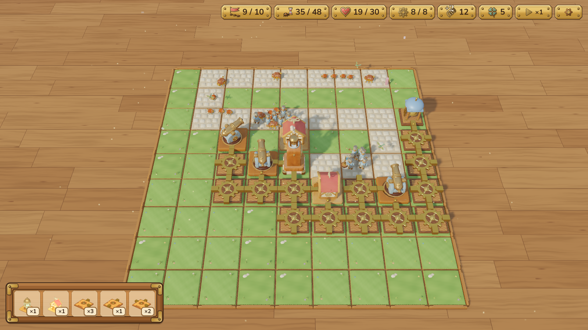
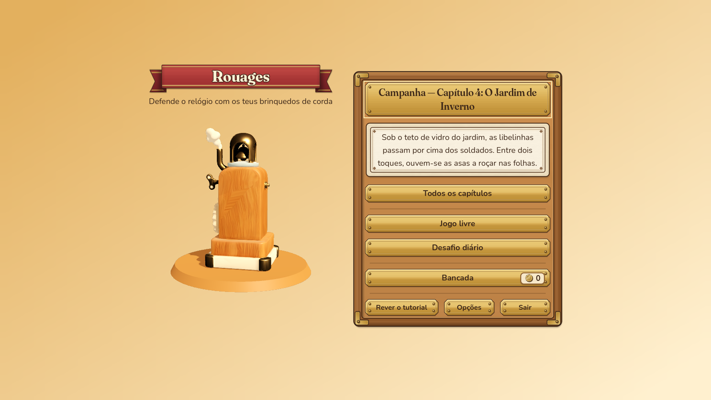
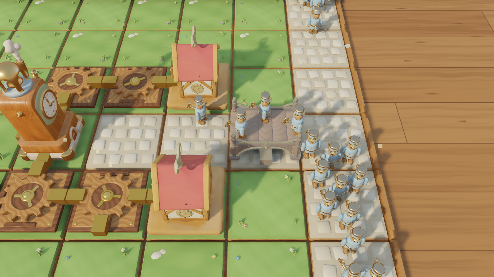

# ⚙️ Rouages

**A clockwork tower defense on a wooden model village.**
At the centre of a toy model sits the Mother Clock. Its gears wind up workshops that churn out swarms of wind-up toys, while swarms of mechanical beetles march towards it at every chime. You are the invisible hand that places the pieces.


<p align="center">
  
</p>

<p align="center">
  
  
</p>

## The game

- **A board that grows.** Between waves, draft 1 lot out of 3 and place tiles. Each tile has gear ports on its sides, and rotating it rotates the ports.
- **Energy flows from the clock** through gear chains (a BFS recomputed only when the board changes). Only powered workshops produce toys.
- **Swarm against swarm.** Data-oriented `SwarmSim`: flow field to the clock, spatial grid for combat, one `MultiMesh` per unit type, no physics engine. The target is 300 vs 300 at 60 FPS.
- **10-wave runs (~15 min),** a campaign with a story, free play, a daily challenge, meta-progression, chests with rare turrets, and boss waves.
- **Three languages:** French, English and Portuguese.

## How it's built: one project lead, several AI agents

Rouages is my experiment in **running a software project with a team of AI agents**. I'm the product owner: I play, test, validate and decide. The agents each have a strict role:

| Role | Who | Scope |
|---|---|---|
| Product owner, playtests, validation | **Me** | Every 🚦 checkpoint in the [roadmap](docs/roadmap.md) |
| Project lead: architecture, game design, balancing, reviews | **Claude Code** | Writes one-page task briefs in [`taches/`](taches/) and integrates the results |
| Delegated code | **Codex** (through [`codex_bridge.sh`](scripts/codex_bridge.sh)) | Only the files listed in its brief: `game/`, `data/`, `tests/` |
| Art direction, UI, Blender, icons | **Gemini** (Antigravity, through an MCP bridge) | Limited to `assets/` and `art_refs/` |
| 3D models | **Hyper3D** | Generated only from images I approved, on a tracked credit budget |

**The reviewer is never the producer.** Claude reviews Codex and Gemini, and Codex reviews what Claude writes alone. The rules every agent follows are in [`AGENTS.md`](AGENTS.md) and [`CLAUDE.md`](CLAUDE.md), and every brief has a contract, allowed files, out-of-scope items and a definition of done.

The result: **71 commits and 146 headless tests in the first five days**, from an empty folder to Mac and Windows builds.

## Architecture

```
game/
  board/       grid, tiles, energy propagation (pure logic)
  swarm/       SwarmSim: flow field, spatial grid, combat (pure logic)
  waves/ workshops/ draft/   run rules
  core/        Events bus, Run state machine (DRAFT → BUILD → WAVE → END)
  ui/ camera/  visuals that observe state, never own it
data/          all balancing as .tres Resources, never hard-coded
assets/        3D kit, materials, UI, procedurally synthesised audio
tests/         headless logic tests
taches/        the task briefs given to the agents, plus their reviews
docs/          architecture, game design, lore, roadmap
```

Key principle: **the logic never knows about the visuals.** That made it possible to swap the greybox for real 3D without touching gameplay, and let Codex (`game/`) and Gemini (`assets/`) work in parallel without conflicts. Details in [`docs/architecture.md`](docs/architecture.md).

## Run it

1. Install [Godot 4.7](https://godotengine.org/)
2. Open `project.godot` and press **F5**
3. Tests: `./scripts/tests.sh`

## Credits

- All sounds and music are **synthesised** by [`scripts/generer_sons.py`](scripts/generer_sons.py): no samples, nothing to license.
- 3D models generated with Hyper3D from validated concept images (log in [`assets/CREDITS_HYPER3D.md`](assets/CREDITS_HYPER3D.md)).
- Fonts under the SIL Open Font License.

Documentation and code comments are in French, my working language.

## License

Code under the [MIT License](LICENSE).
